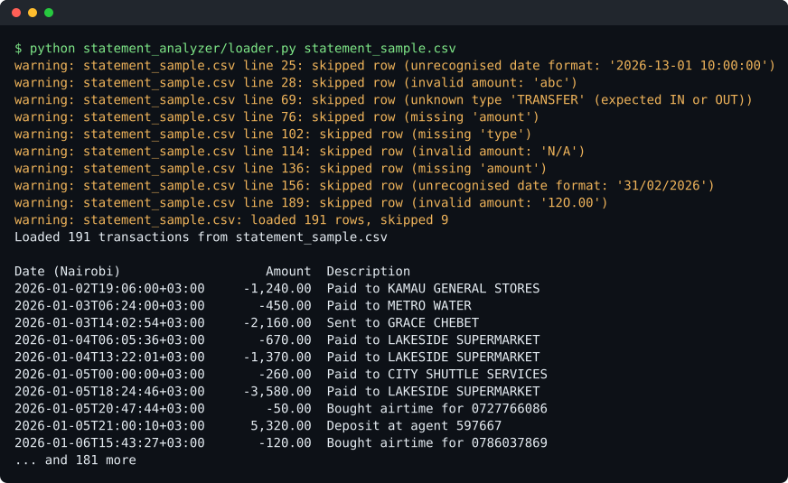
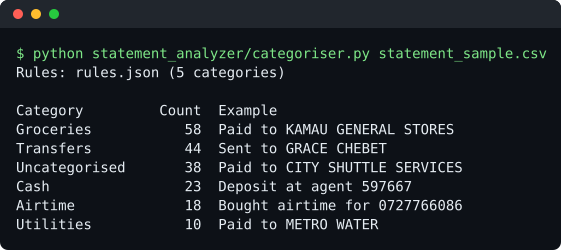
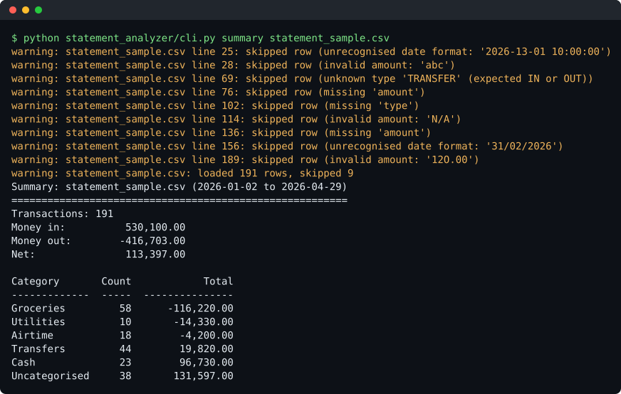
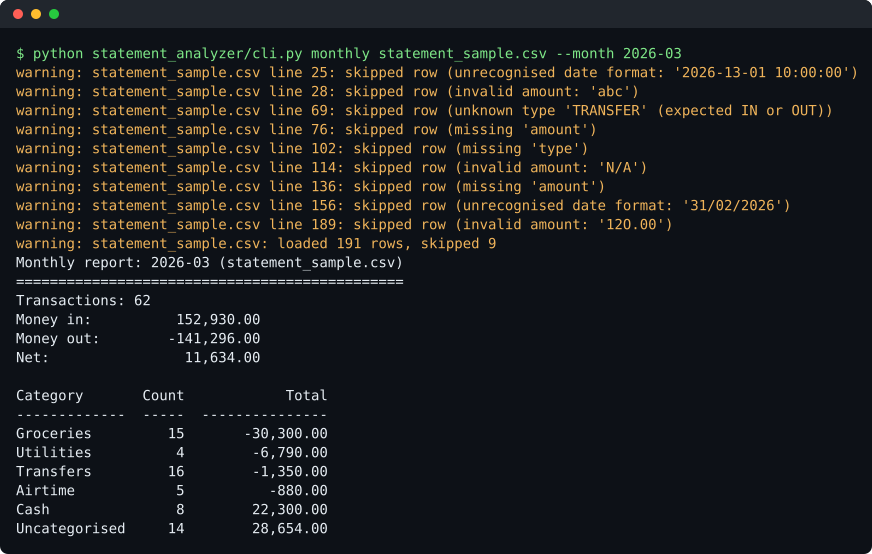
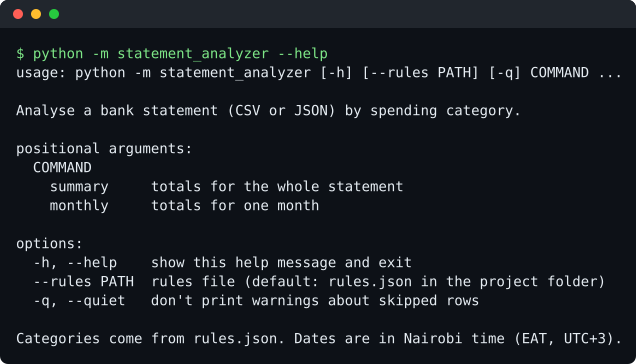

# Statement Analyzer

A Python package that reads a bank statement (CSV or JSON), sorts each transaction into a spending category using regex rules from `rules.json`, and prints totals for the whole statement or for a single month.

- Mixed date formats are read as Nairobi-time datetimes (EAT, UTC+3).
- Bad rows are skipped and logged with their line number instead of stopping the run.
- Categories come from `rules.json`, so you can add one without changing any code.

## Project layout

```
day-3.1-labs/
├── statement_analyzer/      the package
│   ├── __init__.py
│   ├── __main__.py          lets you run `python -m statement_analyzer`
│   ├── cli.py               command-line interface (summary, monthly)
│   ├── loader.py            reads CSV/JSON statements
│   └── categoriser.py       applies the regex rules
├── rules.json               category rules
├── statement_sample.csv     sample statement (includes some deliberately bad rows)
└── screenshots/             output of each script
```

## Setup

You need Python 3.11 or newer. There are no third-party packages to install.

```
git clone <this repository's URL>
cd day-3.1-labs
```

Run every command below from the `day-3.1-labs` folder.

## Steps to run each script

### 1. `loader.py`: load a statement

```
python statement_analyzer/loader.py statement_sample.csv
```

This reads the statement, logs every row it had to skip with its line number, and prints the first 10 transactions with their Nairobi-time dates.



### 2. `categoriser.py`: categorise transactions

```
python statement_analyzer/categoriser.py statement_sample.csv
```

This applies the rules in `rules.json` and shows how many transactions fall in each category, with an example of each.



### 3. `cli.py summary`: totals for the whole statement

```
python statement_analyzer/cli.py summary statement_sample.csv
```

Or, using the package:

```
python -m statement_analyzer summary statement_sample.csv
```



### 4. `cli.py monthly`: totals for one month

```
python statement_analyzer/cli.py monthly statement_sample.csv --month 2026-03
```

Or, using the package:

```
python -m statement_analyzer monthly statement_sample.csv --month 2026-03
```



Add `-q` before the subcommand to hide the skipped-row warnings, for example `python -m statement_analyzer -q summary statement_sample.csv`.

## `python -m statement_analyzer --help`



```
usage: python -m statement_analyzer [-h] [--rules PATH] [-q] COMMAND ...

Analyse a bank statement (CSV or JSON) by spending category.

positional arguments:
  COMMAND
    summary     totals for the whole statement
    monthly     totals for one month

options:
  -h, --help    show this help message and exit
  --rules PATH  rules file (default: rules.json in the project folder)
  -q, --quiet   don't print warnings about skipped rows

Categories come from rules.json. Dates are in Nairobi time (EAT, UTC+3).
```

Help for each subcommand:

```
$ python -m statement_analyzer summary --help
usage: python -m statement_analyzer summary [-h] FILE

Show money in, money out, net, and totals per category for the whole
statement.

positional arguments:
  FILE        statement file (.csv or .json)

options:
  -h, --help  show this help message and exit
```

```
$ python -m statement_analyzer monthly --help
usage: python -m statement_analyzer monthly [-h] --month YYYY-MM FILE

Show money in, money out, net, and totals per category for one month.

positional arguments:
  FILE             statement file (.csv or .json)

options:
  -h, --help       show this help message and exit
  --month YYYY-MM  month to report on, e.g. 2026-03
```

## Statement files

Each transaction needs a date, a description and an amount.

**CSV** with a header row, like `statement_sample.csv`:

```
timestamp,details,type,amount
02/01/2026 7:06 PM,Paid to KAMAU GENERAL STORES,OUT,"1,240.00"
2026-01-05 21:00:10,Deposit at agent 597667,IN,"5,320.00"
```

**JSON**, either a list of transactions or an object with a `transactions` list:

```json
{"transactions": [
  {"date": "2026-03-05", "description": "Uber trip", "amount": -650}
]}
```

- **Column names:** these are case-insensitive, and common alternatives work. The date can be `date`, `timestamp` or `transaction_date`. The description can be `description`, `details`, `narration` or `merchant`.
- **Money in or out:** if there's a `type` column, `IN` makes the amount positive and `OUT` makes it negative. Without a `type` column, the amount's own sign is used.
- **Amounts:** these can use thousands separators (`1,240.00`) or brackets for negatives (`(450.00)`).
- **Date formats:**
  - ISO, such as `2026-01-03 14:02:54` or `2026-01-03T11:02:54Z`
  - `DD/MM/YYYY`, with or without a 12- or 24-hour time, such as `02/01/2026 7:06 PM`
  - written-out dates such as `March 14 2026`
  - Ambiguous dates are read day-first, so `05/03/2026` is 5 March.
- **Time zone:** every date is converted to Nairobi time. A UTC timestamp late on the last day of a month can therefore fall in the next month.

### Bad rows

A row that can't be read is skipped and logged with its line number. The program still processes the rest of the file. The sample file has 9 such rows:

```
warning: statement_sample.csv line 25: skipped row (unrecognised date format: '2026-13-01 10:00:00')
warning: statement_sample.csv line 28: skipped row (invalid amount: 'abc')
warning: statement_sample.csv line 69: skipped row (unknown type 'TRANSFER' (expected IN or OUT))
...
warning: statement_sample.csv: loaded 191 rows, skipped 9
```

A missing file, invalid JSON, or an unsupported file type stops the program with `error: ...` and exit code 1.

## Categories (`rules.json`)

Each category maps to a regular expression that is matched against the description, ignoring case:

```json
{
  "Groceries": "SUPERMARKET|GENERAL STORES",
  "Airtime": "^Bought airtime",
  "Utilities": "POWER PREPAID|WATER",
  "Transfers": "^Sent to|^Received from",
  "Cash": "^Withdrawn at agent|^Deposit at agent"
}
```

To add a category, add a line to `rules.json`, for example `"Income": "^Salary from"`. You don't need to change any code.

- Rules are checked from top to bottom and the first match wins.
- Transactions that match nothing are counted as `Uncategorised`.
- An invalid regex stops the program with an error that names the rule.
- An extended format is also supported. It allows several patterns per category and a custom default category; see the docstring at the top of `statement_analyzer/categoriser.py`.
